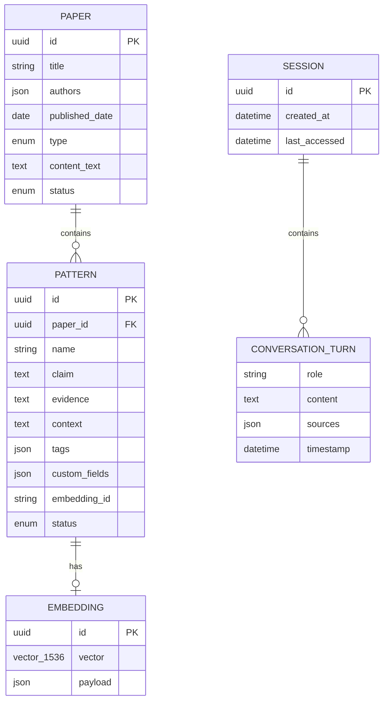
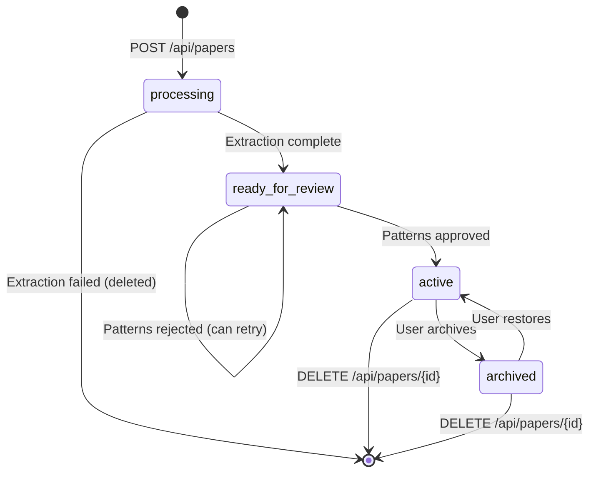
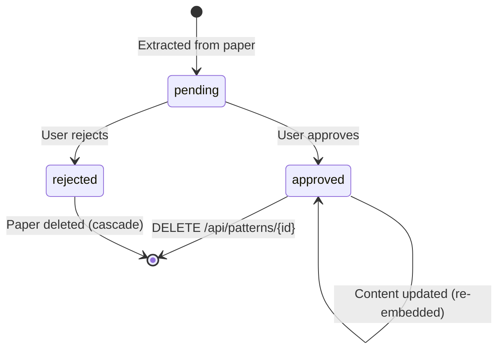

# Domain Model

> **Document Type:** Entity-Relationship documentation
> **Status:** Specification (pre-implementation)

---

## Overview

Research Vault centers on two core entities: **Papers** (source documents) and **Patterns** (extracted knowledge). The system transforms unstructured research content into structured, queryable knowledge using the Claim/Evidence/Context schema.



---

## Core Entities

### Paper

A research document ingested into the system.

| Field | Type | Constraints | Description |
|-------|------|-------------|-------------|
| `id` | UUID (String 36) | PK | Unique identifier |
| `title` | String(500) | NOT NULL | Paper title |
| `authors` | JSON | Nullable | List of author names `["Name 1", "Name 2"]` |
| `date` | Date | Nullable | User-editable effective date |
| `source` | String(1000) | Nullable | URL or source reference |
| `published_date` | Date | Nullable | Original publication date |
| `type` | Enum | NOT NULL | See `PaperType` enum |
| `content_text` | Text | Nullable | Full extracted text |
| `status` | Enum | NOT NULL | See `PaperStatus` enum |
| `created_at` | DateTime(UTC) | NOT NULL | Record creation |
| `updated_at` | DateTime(UTC) | NOT NULL | Last modification |

**Enums:**

```python
class PaperType(str, Enum):
    research_paper = "research_paper"
    blog_post = "blog_post"
    article = "article"
    technical_report = "technical_report"
    book_chapter = "book_chapter"

class PaperStatus(str, Enum):
    processing = "processing"           # Upload in progress
    ready_for_review = "ready_for_review"  # Patterns extracted
    active = "active"                   # Approved and queryable
    archived = "archived"               # Hidden from queries
```

**Indexes:**
- `idx_papers_status_type_date` on `(status, type, published_date)` - Optimizes filtered listing

**Relationships:**
- Has many `Pattern` (cascade delete)

---

### Pattern

A structured pattern extracted from a paper using the Claim/Evidence/Context schema.

| Field | Type | Constraints | Description |
|-------|------|-------------|-------------|
| `id` | UUID (String 36) | PK | Unique identifier |
| `paper_id` | UUID (String 36) | FK, NOT NULL | Reference to parent paper |
| `name` | String(200) | NOT NULL | 3-6 word pattern name |
| `claim` | Text | Nullable | Main assertion or finding |
| `evidence` | Text | Nullable | Supporting quote, data, or example |
| `context` | Text | Nullable | Implications, limitations, connections |
| `tags` | JSON | Nullable | List of tags `["methodology", "finding"]` |
| `custom_fields` | JSON | Nullable | Extensible key-value pairs |
| `embedding_id` | String(100) | Nullable | Qdrant point ID |
| `status` | Enum | NOT NULL | See `PatternStatus` enum |
| `created_at` | DateTime(UTC) | NOT NULL | Record creation |
| `updated_at` | DateTime(UTC) | NOT NULL | Last modification |

**Enum:**

```python
class PatternStatus(str, Enum):
    pending = "pending"      # Awaiting review
    approved = "approved"    # Stored in vector DB
    rejected = "rejected"    # Not stored
```

**Indexes:**
- `idx_patterns_paper_id` on `(paper_id)` - FK lookup
- `idx_patterns_status` on `(status)` - Status filtering
- `idx_patterns_paper_status` on `(paper_id, status)` - Review workflow queries

**Relationships:**
- Belongs to `Paper`

**Invariants:**
- At least one of `claim`, `evidence`, or `context` must be non-null
- `embedding_id` is set only when `status = approved`

**Helper Properties:**

```python
@property
def has_valid_content(self) -> bool:
    """Return True if at least one content field is set."""
    return bool(self.claim or self.evidence or self.context)

@property
def content_fields(self) -> list[str]:
    """Return list of non-null content field names."""
    fields = []
    if self.claim:
        fields.append("claim")
    if self.evidence:
        fields.append("evidence")
    if self.context:
        fields.append("context")
    return fields
```

---

### Embedding (Qdrant)

Vector representation of an pattern stored in Qdrant for semantic search.

**Not a SQLAlchemy model** - stored in Qdrant vector database.

| Field | Type | Description |
|-------|------|-------------|
| `id` | UUID | Same as Pattern.id |
| `vector` | float[1536] | OpenAI embedding |
| `payload` | JSON | Metadata for filtering |

**Payload Structure:**

```python
payload = {
    "pattern_id": str,          # Pattern UUID
    "paper_id": str,            # Parent paper UUID
    "paper_type": str,          # PaperType value
    "paper_status": str,        # PaperStatus value
    "pattern_status": str,      # PatternStatus value
    "tags": list[str],          # Pattern tags
    "name": str,                # Pattern name
    "published_date": str | None,  # ISO date string
}
```

**Invariant:**
- Embedding exists in Qdrant if and only if `Pattern.status = approved` and `Pattern.embedding_id` is set

---

### ConversationSession (In-Memory)

A query session maintaining conversation history.

**Not a database model** - stored in Python dict.

| Field | Type | Description |
|-------|------|-------------|
| `session_id` | UUID | Unique session identifier |
| `history` | List[ConversationTurn] | Ordered conversation turns |
| `created_at` | DateTime(UTC) | Session creation time |
| `last_accessed` | DateTime(UTC) | Last activity (for TTL) |

**ConversationTurn Structure:**

```python
class ConversationTurn(BaseModel):
    role: Literal["user", "assistant"]
    content: str
    sources: list[SourceReference] | None = None
    timestamp: datetime
```

**Invariants:**
- Session expires after 30 minutes of inactivity (TTL)
- Max 100 turns per session
- Max 100KB content per turn

---

## Entity Lifecycle

### Paper Lifecycle



**State Transitions:**

| From | To | Trigger |
|------|----|---------|
| `[none]` | `processing` | `POST /api/papers` |
| `processing` | `ready_for_review` | Ingestion workflow success |
| `processing` | `[deleted]` | Ingestion workflow failure |
| `ready_for_review` | `active` | Pattern review with approvals |
| `active` | `archived` | User action |
| `archived` | `active` | User restores |

### Pattern Lifecycle



**State Transitions:**

| From | To | Trigger | Side Effects |
|------|----|---------|--------------|
| `[none]` | `pending` | Ingestion workflow | Temporary storage |
| `pending` | `approved` | Review workflow | Embedded in Qdrant |
| `pending` | `rejected` | Review workflow | Not embedded |
| `approved` | `approved` | `PUT /api/patterns/{id}` | Re-embedded if content changed |
| `approved` | `[deleted]` | `DELETE /api/patterns/{id}` | Removed from Qdrant |

---

## Aggregate Boundaries

### Paper Aggregate

The **Paper** is an aggregate root containing:
- Paper metadata
- Raw content text
- Collection of Patterns

**Consistency boundary:** All patterns for a paper are managed through the paper aggregate.

**Transaction scope:**
- Paper creation/deletion is atomic
- Pattern approval is batched per paper

### Session Aggregate

The **Session** is an aggregate root containing:
- Session metadata
- Collection of ConversationTurns

**Consistency boundary:** Session updates are atomic (single-writer, in-memory).

---

## Cross-Aggregate References

| From | To | Reference Type | Consistency |
|------|----|----------------|-------------|
| Pattern | Paper | Foreign key | Strong (cascade delete) |
| Embedding | Pattern | ID match | Eventually consistent |
| Session | Pattern | ID reference in sources | Weak (snapshot at query time) |

---

## Data Transfer Objects (Schemas)

### Input Schemas

| Schema | Used By |
|--------|---------|
| `PaperUploadRequest` | `POST /api/papers` |
| `PatternDecision` | `POST /api/papers/{id}/patterns` |
| `PatternUpdateRequest` | `PUT /api/patterns/{id}` |
| `QueryRequest` | `POST /api/query` |
| `FollowupQueryRequest` | `POST /api/query/followup` |
| `QueryFilters` | Query filtering |

### Output Schemas

| Schema | Returned By |
|--------|-------------|
| `PaperUploadResponse` | `POST /api/papers` |
| `PaperResponse` | `GET /api/papers/{id}` |
| `PaperListResponse` | `GET /api/papers` |
| `PatternResponse` | Pattern endpoints |
| `PatternReviewResponse` | `POST /api/papers/{id}/patterns` |
| `QueryResponse` | Query endpoints |
| `SourceReference` | Embedded in QueryResponse |

### Internal Schemas

| Schema | Used For |
|--------|----------|
| `ExtractedPattern` | Workflow intermediate state |
| `PaperMetadataExtracted` | LLM extraction result |
| `IngestionState` | LangGraph state |
| `ConversationTurn` | Session history |
| `ConversationSession` | Session storage |

---

## Validation Rules

### Paper Validation

| Rule | Error |
|------|-------|
| File size < 10MB | 400 Bad Request |
| File type PDF or text | 400 Bad Request |
| Title max 500 chars | Pydantic validation |

### Pattern Validation

| Rule | Error |
|------|-------|
| At least one of claim/evidence/context | Pydantic `model_validator` |
| Name required, max 200 chars | Pydantic validation |
| Tags must be list of strings | Pydantic validation |

### Query Validation

| Rule | Error |
|------|-------|
| Query non-empty | Pydantic `min_length=1` |
| Session ID format UUID | Pydantic validation |
| Date range valid | `date_to >= date_from` |

---

## Database Schema (SQL)

### Papers Table

```sql
CREATE TABLE papers (
    id VARCHAR(36) PRIMARY KEY,
    title VARCHAR(500) NOT NULL,
    authors JSON,
    date DATE,
    source VARCHAR(1000),
    published_date DATE,
    type VARCHAR(20) NOT NULL,
    content_text TEXT,
    status VARCHAR(20) NOT NULL,
    created_at DATETIME NOT NULL,
    updated_at DATETIME NOT NULL
);

CREATE INDEX idx_papers_status_type_date
    ON papers (status, type, published_date);
```

### Patterns Table

```sql
CREATE TABLE patterns (
    id VARCHAR(36) PRIMARY KEY,
    paper_id VARCHAR(36) NOT NULL REFERENCES papers(id) ON DELETE CASCADE,
    name VARCHAR(200) NOT NULL,
    claim TEXT,
    evidence TEXT,
    context TEXT,
    tags JSON,
    custom_fields JSON,
    embedding_id VARCHAR(100),
    status VARCHAR(20) NOT NULL,
    created_at DATETIME NOT NULL,
    updated_at DATETIME NOT NULL
);

CREATE INDEX idx_patterns_paper_id ON patterns (paper_id);
CREATE INDEX idx_patterns_status ON patterns (status);
CREATE INDEX idx_patterns_paper_status ON patterns (paper_id, status);
```

---

## Qdrant Collection Schema

**Collection:** `patterns`

```python
VectorParams(
    size=1536,  # OpenAI embedding dimensions
    distance=Distance.COSINE
)
```

**Payload Schema:**

```json
{
  "pattern_id": "uuid-string",
  "paper_id": "uuid-string",
  "paper_type": "research_paper|blog_post|article|...",
  "paper_status": "processing|ready_for_review|active|archived",
  "pattern_status": "pending|approved|rejected",
  "tags": ["tag1", "tag2"],
  "name": "string (max 200 chars)",
  "published_date": "YYYY-MM-DD" | null
}
```
